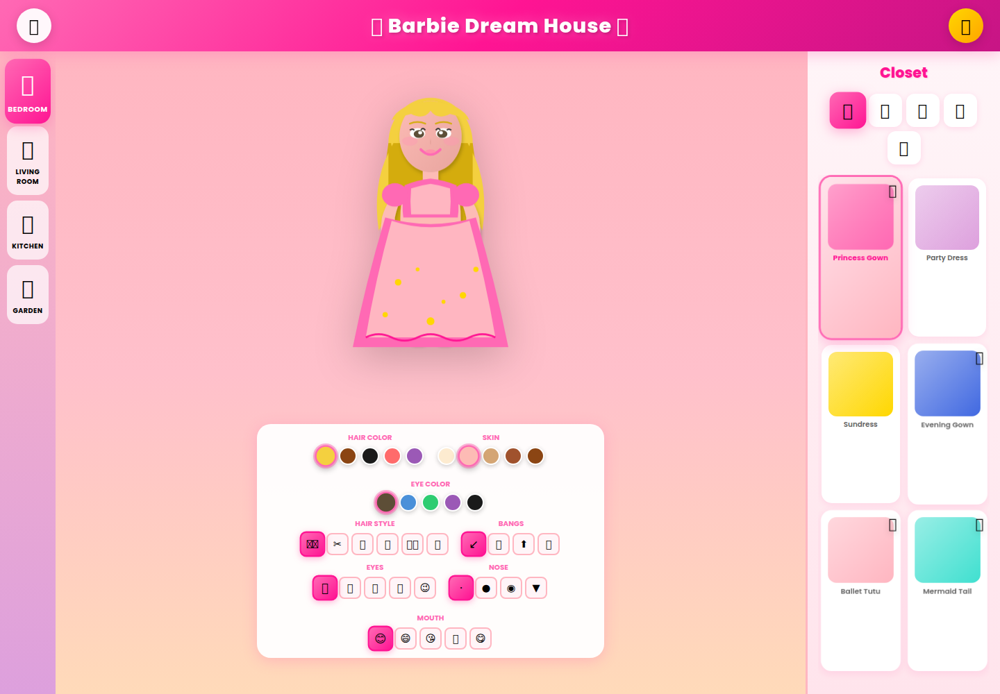

# Barbie Dream House

Step inside Barbie's Dream House and create a look that's all your own. Explore the rooms, try on outfits, and customize Barbie from head to toe.



## Features

- **Dress up Barbie** — mix and match dresses, tops, bottoms, shoes, and accessories. Special items (marked ⭐) include the Princess Gown, Mermaid Tail, Fairy Wings, and more.
- **Customize appearance** — change hair color, skin tone, eye color, hair style, bangs, eyes, nose, and mouth.
- **Explore 4 rooms** — Bedroom, Living Room, Kitchen, and Garden, each with its own decorations.
- **Sound effects** — sparkles, chimes, and whooshes synthesized with the Web Audio API (no audio files needed). Mute anytime with the 🔊 button.

## How to play

- Select **Let's Play!** to enter the Dream House.
- Visit the **Bedroom**, **Living Room**, **Kitchen**, and **Garden** using the room buttons on the left.
- Browse the closet on the right by category. Select an item to wear it, or select it again to take it off.
- Dresses and tops/bottoms are mutually exclusive — picking one automatically removes the other.
- Change Barbie's hair, skin, eyes, and expression with the controls below her. Use the top-right 🔄 button to clear the outfit.

## Play locally

With Node.js and npm installed, run:

```sh
npm ci
npm run dev
```

Open the local URL shown in your terminal (usually <http://localhost:5173/>).

### Other scripts

```sh
npm run build    # production build to dist/
npm run preview  # preview the production build
npm run lint     # lint with ESLint
```

## Tech stack

- [React 19](https://react.dev) + [Vite 7](https://vite.dev)
- Pure inline SVG — every outfit, decoration, and Barbie herself is drawn with SVG (no image assets)
- Web Audio API for synthesized sound effects

## Project structure

```
src/
├── App.jsx               # Main game state and layout
├── components/
│   ├── WelcomeScreen.jsx # "Let's Play!" start screen
│   ├── Barbie.jsx        # SVG Barbie with customizable features
│   ├── Wardrobe.jsx      # Closet panel with category tabs
│   ├── ClothingItem.jsx  # Single closet item card
│   ├── Sparkles.jsx      # Sparkle burst effect on outfit changes
│   ├── House.jsx         # House overview with all rooms
│   ├── Room.jsx          # Individual room scene
│   └── RoomSelector.jsx  # Room tab navigation
├── data/
│   ├── clothes.jsx       # All clothing/accessory SVG definitions
│   └── rooms.jsx         # Room definitions and SVG decorations
└── hooks/
    └── useSound.js       # Web Audio sound effects hook
```

## Customizing content

- **Add clothing**: add an entry to a category in `src/data/clothes.jsx` with an `id`, `name`, `category`, `svg` (inline SVG drawn for a `0 0 300 500` viewBox), and a `thumbnail` color.
- **Add rooms**: add an entry to `src/data/rooms.jsx` with an `id`, `name`, `icon`, gradient `background`, and `decorations` (reusing shapes from `roomDecorations`).
